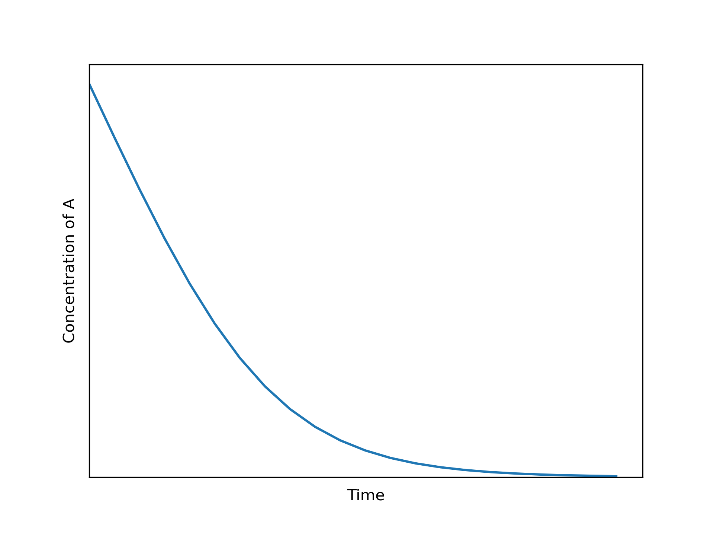
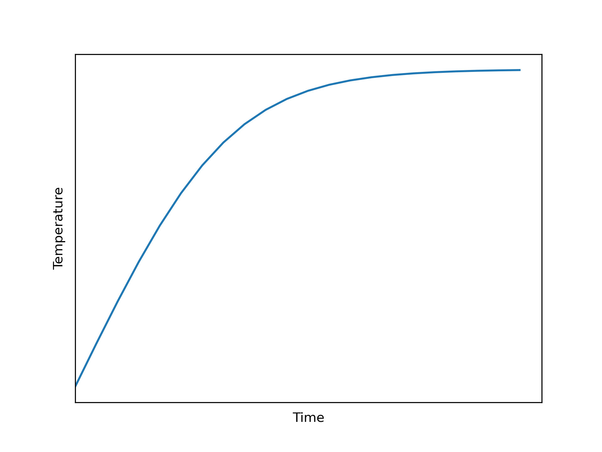
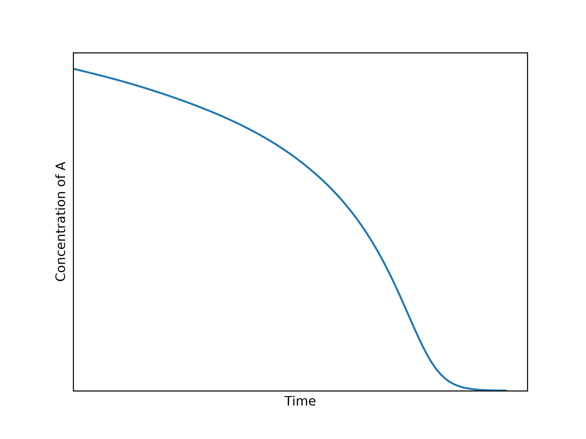
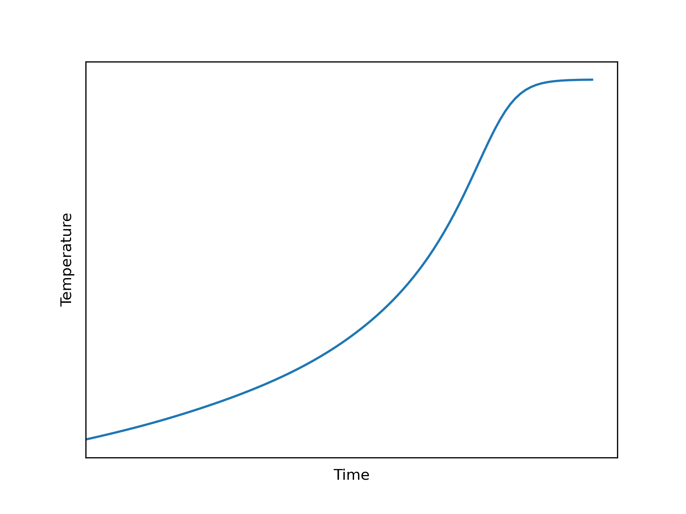
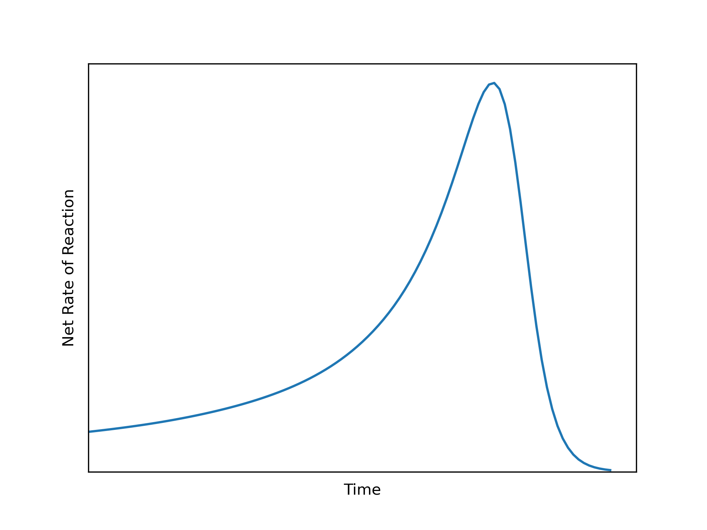
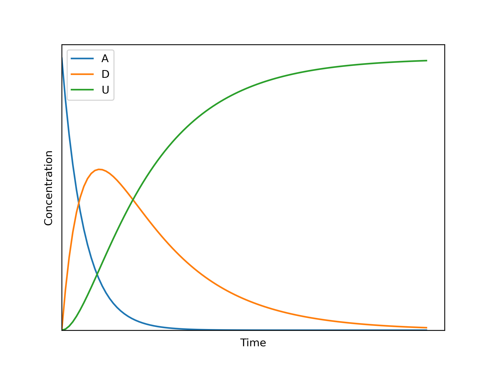
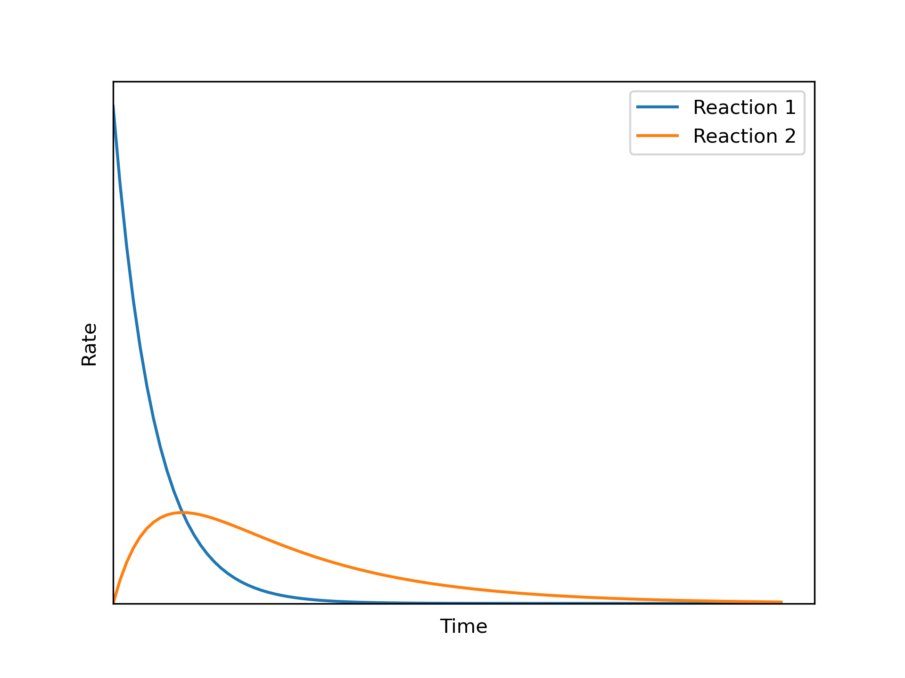

# Reactor Analysis {#sec-ch5}

Chemical reactions, and particularly their rates, were the focus of Chapters -@sec-ch2, -@sec-ch3, and -@sec-ch4. Attention now shifts to the reactors in which reactions occur and their mathematical modeling.

## Learning Objectives {#sec-ch5_objectives}

Upon completion of this chapter, readers should

* know the definitions of and differences between 
    * steady-state, transient, isothermal, adiabatic, non-adiabatic, isobaric, and isochoric reactor operation
    * sensible and latent heat
    * analysis, parametric analysis, optimization, design, and parameter estimation tasks
* be able to describe the general workflow used to complete reaction engineering assignments in *Reaction Engineering Basics* 
* be able to qualitatively describe how composition, temperature, and related quantities evolve with reaction time, given appropriate information about rate expressions, reaction exothermicity, and reactor heat exchange
* be able to select the design equations that are needed for modeling a specified reactor
* be able to write the energy balance on an exchange fluid that exchanges either sensible heat or latent heat with the reacting fluid in a reactor

## Reactors and Reactor Modeling

A piece of equipment within which chemical reactions take place is called a reactor. A reactor model is a set of equations that establish a quantitative relationship between what goes into a reactor, what comes out of the reactor, physical properties of the reactor, and the manner in which the reactor is operated. Mathematical models of reactors are essential for reaction engineering analyses. 

Assumptions are made when formulating the equations for modeling reactors. Those assumptions affect the accuracy and rigor of the model as well as the mathematical methods necessary for using it. "Ideal" reactor models make assumptions about the flow and mixing of the fluid in a reactor that offer a good compromise between accuracy and mathematical tractability. The set of equations needed to model a reactor are called the design equations for that reactor.

Four ideal reactor models will be considered in subsequent chapters. Herein reactors that conform to those four ideal reactor models are called batch stirred tank reactors (BSTRs), semibatch stirred tank reactors (SBSTRs), continuous stirred tank reactors (CSTRs), and plug-flow reactors (PFRs). Reactions take place intermittently in BSTRs and SBSTRs whereas in CSTRs and PFRs reactions occur continuously. Continuous reactors wherein temperature, pressure and composition at each point do not change over time are said to operate at steady-state. In transient operation, temperature, pressure, and/or composition change over time at some locations within the reactor.

If the temperature is the same everywhere, the reactor is said to be isothermal. If the pressure is the same everywhere it is isobaric, and if the reacting fluid does not expand or contract anywhere, the reactor is isochoric (constant volume). If no heat enters or leaves the reactor other than that associated with reacting fluid flowing in and out, the reactor is adiabatic. If a reactor is not adiabatic, heat is either removed from or added to the reactor. This heat transfer must be accounted for in the design equations for that reactor. As discussed more fully below, this can be accomplished in a number of ways.

## Reactor Analysis Workflow {#sec-ch5_workflow}

The completion of reaction engineering assignments involves solving the reactor design equations and using the solution to accomplish a reaction engineering task. While analytical solution of the design equations is sometimes possible, for most meaningful reaction engineering assignments the design equations must be solved numerically. So, for the sake of consistency, the reactor design equations are solved numerically in all *Reaction Engineering Basics* assignments. This section establishes a consistent workflow for the completion of reaction engineering assignments using numerical solution of the reactor design equations. 

The workflow described here will be used in every example assignment presented in the next four chapters. It provides a consistent approach for reaction engineering analyses that is structured for straightforward implementation as computer code using whatever programming language and environment the reader chooses. The assignments in the next four chapters all involve the analysis of a single ideal reactor. In later chapters this workflow will be expanded to encompass other types of analyses.

The workflow mimics the information a reaction engineer might record in a notebook while completing an assignment, and then refer to later when writing a report or making a presentation based on the assignment. The description that follows is terse in places, but the workflow should quickly become familiar as examples in the chapters that follow illustrate its use.

**Assignment Summary**

The workflow begins with an assignment summary. It is a concise listing of the information provided in the assignment narrative, the information it requests, and any additional information that is needed to complete the assignment. The intention is that the assignment summary should be sufficient to complete the assignment without having to read the assignment narrative again. 

Every assignment summary will list the reactions taking place, rate expressions for those reactions, reactor details, given constants, and given equations. If a basis can be chosen, it will indicate the basis for the calculations. The type of task (see below) is then identified, including associated parameters and optimization targets, if any. The "Items of Interest" are then listed. These are quantities requested directly in the assignment, or quantities that are needed in order to meet the assignment requests. Finally, if the assignment requests an assessment, recommendation, etc. they are listed as "Additional Deliverables."

**Preliminary Analysis**

The second component of the workflow is a preliminary analysis. This is a qualitative analysis (see below) where the engineer identifies the important factors that can affect the results, and describes the possible outcomes on a physical basis. Once the quantitative analysis has been completed, this section is used to identify any unanticipated results that should be explained in the discussion section.

**Reactor Model Function**

Solving the reactor design equations is central to all assignments. Since they will be solved numerically, this section is structured to facilitate writing a computer function that solves the design equations. It starts with a listing of the design equations that are needed for modeling the reactor as specified in the assignment narrative. For each necessary design equation, zero-valued terms are eliminated, summations and continuous products are expanded, and sensible heat terms are revised to use available heat capacities.

Next the reactor model variables, that is, the variables that will be found by solving the design equations, are listed. In addition to the reactor model variables, and the given constants, the design equations will contain additional unknowns. Any additional unknowns that cannot be calculated from the reactor model variables and given constants are next listed as "non-computable" unknowns, along with an indication that they will need to be provided to the reactor model function as arguments. If any of the non-computable unknowns need to be made available to a residuals or derivatives function that cannot receive them as arguments, this is also indicated. 

The reactor model function definition continues with the identification and listing of the additional unknowns that can be calculated from the reactor model variables and given constants. They are listed as "computable" unknowns, followed by the equations for calculating them. If the equation for calculating one additional unknown introduces a second computable unknown, the second unknow is added to the listing along with the equation for calculating it.

The reactor model function section of the workflow next identifies the type of numerical solver that is needed for solving the design equations and the arguments that must be provided to it. Specifically, if the design equations are ATEs, the initial guesses and the residuals function that will be provided to the ATE solver will be listed, and if they are IVODEs, the initial values, stopping criterion and derivatives function that will be provided to the IVODE solver are listed along with equations for calculating them. If initial values, the stoping criterion, or equations for calculating use non-computable unknowns, they are added to the listing mentioned above. The algorithm for the residuals or derivatives function is succinctly emumerated.

**Coupled Unknowns Residuals Function**

Coupled unknowns are one type of non-computable unknown that can be encountered when the design equations are IVODEs. They are "coupled" because the equations for calculating them require solution of the IVODEs, but solution of the IVODEs requires the coupled unknowns. The details for calculating coupled unknowns will be described the first time that they are encountered. The important point for present purposes is that coupled unknowns are calculated using an ATE solver. The next section of the workflow lists the ATEs that must be solved to calculate the coupled unknowns. Then the residuals function for solving the ATEs is described, indicating the arguments passed to it, the quantities it returns, and a summary of its algorithm.

**Items of Interest Function**

The phrase "items of interest" is used here to refer to quantities that are directly requested in the assignment narrative together with quantities that are needed or useful for making requested recommendations or assessments. The items of interest function uses the reactor model function and coupled unknowns function as necessary to solve the design equations for the reactor model variables. Then it uses those results to calculate any additional items of interest. The items of interest function also generates any requested graphs.

**Implementation of the Calculations**

The next section of the workflow describes implementation of the calculations in code and execution of that code. Specifics for this step are not provided in *Reaction Engineering Basics, The Book* so that each reader may choose to use the programming language and environment that they prefer. However, *Reaction Engineering Basics, The Course* presents workflows for almost every example in *Reaction Engineering Basics, The Book* that include both Python and Matlab implementations of the calculations.

**Results**

If numerical issues were encountered during the calculations, they are described and the action taken to eliminate them are explained first in the results section. Then the values of the items of interest and any graphs requested in the assignment narrative are presented. 

**Discussion**

A discussion section is the penultimate component of the workflow. This typically requires a qualitative analysis (below) that explains the significant features of the computed results. It is essential that the final results make sense on a physical basis. If the assignment requires the engineer to make an assessment or recommendation, the basis for it is developed in the discussion section.

**Summary**

The workflow ends with a summary that offers a succinct response to the assignment narrative. If the assignment requires an assessment or recommendation, it is included in the summary. The summary is intended to be a stand-alone section that can be read without having to read the rest of the assignment solution.

Some aspects of the workflow defined here may seem ambiguous at this point. The examples included in the next four chapters will illustrate use of the workflow, and should remove any abiguities. This workflow is intended to be general enough to apply to any assignment involving the analysis of an ideal reactor, but should not be viewed as a rigid recipe that must be followed exactly. Later chapters of the book will extend this workflow as new reactor systems or engineering tasks are introduced.

## Reaction Engineering Tasks {#sec-ch5_tasks}

The reactor design equations establish a quantitative relationship between the reactor inputs, outputs, properties, and operational details. In any reactor modeling assignment, the reaction engineer is given values for some of these quantities and tasked with determining the values of the others. The reactor design equations can be used to accomplish a variety of tasks. The tasks encountered in Chapters -@sec-ch6 through -@sec-ch9 can be classified as analysis, parametric analysis, and optimization tasks. The difference between these tasks is found not in the equations themselves, but in how they are solved or used.

**Reactor analysis tasks**, as defined here, are the most straightforward of the tasks. In an assignment that requires reactor analysis, the reaction engineer is provided with a sufficient number of reactor inputs, outputs, properties, and operational details to solve the reactor design equations and calculate the items of interest. Generally there is a single, correct answer to a reactor analysis assignment.

**Parametric reactor analysis tasks** are similar, but the design equations are solved multiple times. The value of a parameter is changed each time they are solved. In one common example, the assignment will ask for a graph where an item of interest is plotted *versus* some other reactor input, output, property, or operational detail. That other input, output, property, or operational detail is the parameter. Another common type of parametric response task simply asks for a comparison of quantity of interest for a limited set of parameter values. Again, each time the reactor design equations are solved, there is generally a single, correct response.

In **optimization tasks** the number of reactor variables that are specified or known is not sufficient to allow the reaction engineer to solve the reactor design equations and calculate the items of interest. The simplest example would task the engineer to maximize (or minimize) an item of interest (the target) with respect to some other reactor input, output, property, or operational detail (the adjusted parameter). Neither the value of the target nor the value of the adjusted parameter are known. In lieu of knowing the actual value of the adjusted parameter, the reaction engineer instead knows that its value is the one that maximizes (or minimizes) the target. Typically the engineer is tasked to find both the optimum value of the target and the corresponding value of the adjusted parameter. Again, there usually is a single correct answer to this type of reactor optimization assignment.

Noting that the design equations will be solved numerically, there are two ways the reaction engineer could approach an optimization task. In the first, a range of values of the adjusted parameter is selected and the design equations are solved repeatedly to find the value of the target corresponding to each value of the adjusted parameter. This produces two vectors, one containing values of the adjusted parameter and the other containing the corresponding values of the target. The vector containing the target values is scanned to identify the maximum value and its index. The corresponding value of the adjusted parameter is then found at the same index in the adjusted parameter vector. Alternatively the target variable can be plotted against the adjusted variable, and the maximum value of the target and the corresponding value of the adjusted variable are read from the graph. If the target does not pass through a maximum or minimum, the range of values of the adjusted parameter must be expanded. This is the approach that is used in *Reaction Engineering Basics.*

Alternatively, many software packages include a function (an optimizer) that finds a maximum or minimum. The second approach to completing optimization tasks involves using such an optimizer. In this case, the numerical implementation of the solution would entail writing an optimization target function that receives the adjusted variable as an argument, calls the reactor model function and uses the result to calculate and return the target variable. That optimization target function would then be passed to the optimizer. Typically an initial guess for the optimum value of the adjusted variable would also need to be provided.

Optimization tasks can be much more complicated than simply maximizing or minimizing a quantity of interest with respect to another reactor parameter. In addition to specifying multiple adjusted parameters, the assignment also could impose constraints on the values of one or more reactor variables (not just the target and adjusted variables). Constraints are conditions that must be obeyed. An example of a constraint would be that the temperature cannot exceed some specified value. Again, there are software packages that will perform constrained, multi-variable optimization. Being an introductory book, and desiring to focus on reaction engineering over programming, *Reaction Engineering Basics* does not use optimization software.

**Reactor design tasks** are more complicated, but at the same time they can be intellectually stimulating, affording the reaction engineer an opportunity to be creative. A reactor design assignment does not provide sufficient information to solve the reactor design equations. The reaction engineer must choose values for the missing reactor variables. In more extreme cases, the assignment may provide little more than the reagents that are available and the products that are to be produced. The type of reactor to use and how to operate it may be among the choices the reaction engineer needs to make.

Design tasks almost always involve an optimization sub-task. The quantity that needs to be maximized is typically financial in nature. The goal is to maximize the rate of making profit subject to technical, regulatory, and financial constraints. Design at this level is typically taught in chemical engineering courses on plant design, and the system being optimized is typically an entire process, not just an isolated reactor. In general, there is not a single correct solution to a reactor design assignment. Design tasks are inherently “open-ended,” and multiple solutions are possible and acceptable.

**Parameter estimation tasks** will be considered in @sec-ch10. They are inherently different from the tasks described above, but they do use the same reactor design equations and those equations are solved the same way as in the other tasks. Briefly, a parameter estimation task involves using a reactor to generate data, and then using the data, together with a model for the reactor, to estimate the values of parameters such as those appearing in a rate expression. The use of the ideal reactor models to estimate rate expression parameters is examined in @sec-ch10. A similar approach can be used to estimate parameters that appear in empirical models for non-ideal reactors such as those considered in @sec-ch12.

## Qualitative Reactor Analysis {#sec-ch5_qual_analysis}

Qualitative analysis of a reactor focuses on how composition, temperature, reaction rate, etc. change as reaction proceeds. It explains the changes on a physical basis without the use of equations. Qualitative analysis is used at two points in the workflow presented above. The preliminary analysis early in the workflow uses qualitative analysis predictively. At that point, qualitative analysis can sometimes provide the expected outcomes of the quantitative analysis to follow. Importantly, when the outcome cannot be predicted, it identifies competing physical effects where the outcome is determined their relative magnitude.

After the quantitative analysis is completed, qualitative analysis is used again in the discussion section to interpret the results. In essence, it fills the gaps in the preliminary analysis. If the results predicted in the preliminary analysis are not realized, it provides a physical basis for understanding why. If the preliminary analysis identified competing physical effects, the discussion brings out their relative importance and rationalizes it. Additionally, qualitative analysis may provide insights toward improving reactor performance.

In batch reactors the time during which reactions occur is measured using clock time. The reaction time equals the elapsed time between the start of the reaction and the time when it stops or is ended. In continuous flow systems, the time during which reactions occur is equal to the amount of time that the reagents spend in the reactor. One measure of the time reagents spend in the reactor is the space time, $\tau$, defined in @eq-space_time. For flow reactors, the mixing of the reacting fluid while it is in the reactor is also critical to a physical understanding of reactor performance. That aspect of qualitative analysis is considered in the chapters on ideal reactors. This chapter focuses on the variation of concentrations, temperature, and reaction rates as functions of reaction time or space time.

$$
\tau = \frac{V}{\dot{V}_{in}}
$$ {#eq-space_time}

Because the analysis is qualitative, the rate expression is not used directly. Instead, the general behavior of reactions must be used, noting that for a typical reaction, holding all other conditions constant,

* the rate will increase if the temperature of the reacting system is increased,
* the rate will decrease if the concentration of one or more reactants decreases,
* the rate is not strongly affected by the concentration of the products if the reaction is irreversible,
* the rate decreases as the concentration of the products increases if the reaction is reversible,
* the equilibrium constant decreases as the temperature increases if the reaction is exothermic, and
* the equilibrium constant increases as the temperature increases if the reaction is endothermic.

Of course, not all reactions behave “typically.” The qualitative analysis methodology presented here also can be applied to atypical reactions if the general behavior above is appropriately adjusted. For example, if the rate increases as the concentration of a *product* increases, the reaction is said to be autocatalytic, and the qualitative behavior can be adjusted accordingly. It is important to note, however, that as a reaction with atypical kinetics approaches thermodynamic equilibrium, its behavior will become "typical".

Four factors need to be considered: reagent concentrations (C), temperature (T), the rates of the reactions (r), and the rate at which heat is being added or removed (Q). Each of those factors is affected by the others, sometimes in opposing directions, and will change over time (t). A general approach to qualitative analysis will be outlined here. It will be illustrated in this chapter using relatively straightforward examples, and then in subsequent chapters additional complications will be introduced.

The goal is to generate graphs that show how concentrations, temperature and reaction rates vary with reaction time. To begin sets of axes for C *vs.* t, T *vs.* t, and r *vs.* t are sketched, and starting values at t = 0 are plotted on them. Typically reactant concentrations will be plotted high on the C axis because they are expected to decrease, and product concentrations are plotted low. Temperature and rate can be plotted near the middle of their axes.

Next a short line segment is extended from each starting value. The purpose of this line segment is to indicate whether each value will increase or decrease over a short interval of time. In some systems this can be ambiguous. In a system with one reaction, the concentration of reactants will decrease and the concentration of products will increase, so a short line segment with a negative slope is extended from the starting reactant concentrations and a short line segment with a positive slopw from the starting product concentrations.

The initial change in temperature can be a bit more complicated because it depends on both the rate of the reaction and the rate of heat transfer. For present purposes consider a single endothermic reaction taking place adiabatically. For such a system, the temperature will decrease initially because heat is absorbed from the reacting fluid to provide the heat of reaction, and no heat is being transferred to the reacting fluid from the surroundings.

Having thus established the directions in which the concentrations and temperature will change in the first short interval of time, the change in the rate during that interval is next inferred, if possible. For a typical reaction, decreasing reactant concentration and decreasing temperature would both tend to decrease the rate. Increasing product concentration would either have no effect, or it, too, would tend to decrease the rate. Thus, for a single endothermic reaction taking place adiabatically the rate will decrease during the first short interval of reaction time. (Later examples will show that the changes in reactant concentration, product concentration and temperature can have opposing effects upon the rate, complicating the analysis.)

Having established the concentrations, temperature, and rate at the end of the first short interval of reaction time. The rate at the end of the first interval is used to determine how the concentrations and temperature will change during the next short interval of reaction time. For a single endothermic reaction occurring adiabatically the reaction rate at the end of the first interval is smaller than at the starting conditions, so the concentration of reactants and the temperature will decrease by less during the second short interval and the concentration of products will increase by less.

That establishes the initial slope and curvature of the plots. For the system being considered here, there were no opposing concentration and temperature factors affecting the rate. As such, the initial trend is expected to continue. The reactant concentration and temperature will continue to decrease by smaller and smaller amounts while the concentration of product increases by smaller and smaller amounts. Eventually the smaller and smaller changes will approach zero, at which point the concentrations and temperature will become constant. If the reaction is irreversible, the final concentration will asymptotically approach zero, and for a reversible reaction it will asymptotically approach the equilibrium concentration.

For many systems, the change in the concentrations and temperature at the end of the first short interval of reaction time will have opposing effects. That complicates the qualitative analysis. First, alternative outcomes must be considered wherein each of the opposing effects is assumed to predominate. Second, as the reaction time increases, there may be a shift from one opposing effect being predominant to a different opposing effect becoming predominant. The examples at the end of this chapter and additional examples in subsequent chapters will illustrate qualitative analysis with different types of additional complications. In all cases, at sufficiently long reaction time, the concentrations and temperature must become constant.

As previously noted, qualitative analyses of this type are used in the discussion of the results of a quantitative analysis. In that context, qualitative analysis can be used to answer questions such as "Do these results make sense?" and "Why does that graph have that shape?" Additionally, performing a qualitative analysis after the quantitative analysis helps new reaction engineers develop a physical understanding of results that complements the mathematical understanding obtained in quantitative analysis. As a reaction engineer gains experience and develops the necessary skills and understanding, qualitative analysis can often provide insight and guidance before beginning an assignment. This is particularly true for reactor design tasks or when troubleshooting a reactor that is not performing as expected.

## Quantitative Reactor Analysis {#sec-ch5_quant_analysis}

As already noted, the reactor design equations establish a mathematical relationship between reactor inputs, outputs,properties, and operational parameters. In quantitative reactor analyses the reactor design equations are solved mathematically to accomplish reaction engineering tasks that include analysis, parametric analysis, optimization, reactor design, and parameter estimation. The general workflow presented above can be used to accomplish any of those types of tasks given the reactor design equations. This final section of @sec-ch5 offers an overview of the different kinds of equations that make up the reactor design equation for any reactor, and then goes into detail on the design equations for use of a heat exchange fluid to add or remove heat from all types of reactors.

### Reactor Design Equations

The three main types of reactor design equations are mole balances, energy balances, and momentum balances. Mole balances relate the input molar amounts to the output molar amounts, so they are always included in a reactor model. A mole balance can be written for each reagent present at any point in the system. That includes reagents that are reactants or products in the reactions that are occurring, as well as reagents that are neither reactants nor products in any of the reactions. The reagents that do not participate in any of the reactions can be referred to as "inerts."

An energy balance on the reacting fluid relates its outlet temperature to its inlet temperature, the net heat released by reactions, the heat exchanged with the surroundings and any mechanical work done on or by the reacting fluid. *Reaction Engineering Basics* only considers one means of adding or removing heat from a reactor. That mode is by transferring heat to or from a separate heat exchange fluid. Normally, separate reacting fluid and exchange fluid energy balances are included among the reactor design equations. However, as discussed below, there are circumstances where a reactor can be modeled without using one or both of these energy balances.

A momentum balance accounts for the conversion of kinetic energy of a flowing fluid to thermal energy. While the magnitude of this energy is negligible with respect to the terms in the energy balance, it can have a significant effect upon the pressure of the flowing fluid. Momentum balances are not needed with any of the ideal stirred tank reactors, but they are sometimes necessary when modeling ideal PFRs. When a momentum balance is not needed, the outlet pressure can be calculated from the other output variables using the equation of state. Herein that means they can be calculated using the ideal gas law or by assuming liquids to have constant density.

In some situations where the design equations are ordinary differential equations, the mole, energy, and momentum balances are found to contain one too many dependent variables. In these cases a differential form of the ideal gas law must be added to the reactor design equations.

### Selecting the Necessary Design Equations

It is not always necessary to use all possible reactor design equations to model a reactor. For example, in closed systems and in open steady-state systems, mole balances do not need to be written for every reagent in the system because the amounts of the reactants and products are related through stoichiometry. As such, if $N_{ind}$ mathematically independent reactions are taking place, only $N_{ind}$ reactant or product mole balances are needed, together with a mole balance for each inert.

Very often for liquid-phase systems with a solvent, it is not necessary to include a mole balance on the solvent. This is true when the sensible heat of the reacting fluid can be expressed in terms of the mass-specific or volume-specific heat capacity of the entire solution.

A momentum balance is only needed when the reactor is an ideal PFR. Even then, if it is known that the pressure drop is negligible, a momentum balance does not need to be included among the design equations.

If a reactor operates adiabatically there will not be an exchange fluid, and consequently an energy balance on the exchange fluid cannot be included among the design equations. If a reactor operates isothermally at a known temperature, the mole balance equations can be solved separately from the two energy balance equations, and the energy balances may not be needed. (True isothermal operation of an industrial reactor is not very common, but laboratory reactors that are used to generate kinetics data normally do operate isothermally.)

There are a number of ways to transfer heat between the reacting fluid and the surrounding environment. *Reaction Engineering Basics* only considers heat exchange with a perfectly mixed heat exchange fluid. If the temperature of that mixed fluid is known and constant, the other reactor design equations can be solved independently from the energy balance on the exchange fluid, and the latter may not be needed. One situation where this can happen is when the exchange fluid undergoes a phase change and exchanges only the latent heat associated with the phase change. Phase changes occur at constant temperature, so, for example, if condensation of saturated steam at 1 atm is being used to supply heat to the reacting fluid, the temperature of the exchange fluid will be constant and equal to 100 °C.

Other times the heat exchange fluid may be treated as a constant temperature thermal sink with a known, constant temperature. In this situation, an energy balance on the exchange fluid is not needed. The other reactor design equations can be solved without it.

### Reactor Heat Transfer {#sec-ch5_exchange_fluid_balances}

Once the design equations needed for modeling a given reactor have been identified, it may be necessary to modify them, and it may be possible to simplify them. The way that is done depends on the type of reactor and the manner in which it is being operated, so modification and simplification of the design equations is considered separately for each reactor type in each of the next four chapters.

However, as already noted, *Reaction Engineering Basics* only considers heat exchange with a perfectly mixed heat exchange fluid. As a consequence, the exchange fluid energy balance is the same for all four ideal reactor types. So, to avoid replicating the discussion of the exchange fluid energy balance in each of those chapters, it is presented here.

When the reacting fluid exchanges heat with a heat exchange fluid, the two fluids do not mix; there is a solid wall that separates them, and heat is transferred through that wall. If the reactor has separate chambers for the reacting fluid and the heat exchange fluid, the chamber containing the heat exchange fluid is often called the shell. Sometimes, instead, the exchange fluid flows through a coil of tubing that is immersed in the reacting fluid, or a heat exchanger external to the reactor is used to transfer heat. In all of these cases, though, heat is transferred between the fluids through a solid wall.

The equations for modeling heat transfer between the reacting fluid and a heat exchange fluid are derived in [Appendix -@sec-apndx_heat_exch]. The exchange fluid is assumed to be a pure, perfectly mixed fluid that either undergoes phase change (exchanges latent heat) or experiences temperature change (exchanges sensible heat), but not both. Consequently, there are two forms of the energy balance on the exchange fluid: one for exchange of latent heat and one for exchange of sensible heat.

#### Exchange of Sensible Heat

When the exchange fluid undergoes only temperature change, the energy balance on it is given by @eq-ext_fluid_energy_bal_sens, which is reproduced here as @eq-exchange_energy_bal_sensible. The term on the left side of the equation represents the accumulation of sensible heat in the exchange fluid. The first term on the right side of the equation represents the rate at which heat is transferred from the exchange fluid to the reacting fluid. The last term represents the change in the sensible heat of the exchange fluid as it flows through the reactor. If the reactor operates at steady-state, the time derivative is equal to zero and the energy balance on the exchange fluid reduces to the form shown in @eq-exchange_energy_bal_sensible_ss.

$$
\rho_{ex} V_{ex} \tilde{C}_{p,ex}\frac{dT_{ex}}{dt} = -\dot{Q} - \dot{m}_{ex} \int_{T_{ex,in}}^{T_{ex,out}} \tilde{C}_{p,ex}dT
$$ {#eq-exchange_energy_bal_sensible}

$$
0 = \dot{Q} + \dot {m}_{ex} \int_{T_{ex,in}}^{T_{ex}} \tilde{C}_{p,ex}dT 
$$ {#eq-exchange_energy_bal_sensible_ss}

In @eq-exchange_energy_bal_sensible and @eq-exchange_energy_bal_sensible_ss the sensible heat terms are expressed using the gravimetric heat capacity of the exchange fluid, $\tilde{C}_{p,ex}$. It has units of energy per mass of exchange fluid per degree of temperature change. The sensible heat terms could also be written using either the volumetric heat capacity ($\breve{C}_p$, energy per volume of exchange fluid per degree of temperature change) or the molar heat capacity ($\hat{C}_p$, energy per mole of exchange fluid per degree of temperature change). @eq-equivalent_sens_heat_accumulation_terms shows the three equivalent ways of writing the accumulation term and @eq-equivalent_sens_heat_terms shows the three equivalent ways of writing the term for the sensible heat change.

$$
\rho_{ex} V_{ex} \tilde{C}_{p,ex}\frac{dT_{ex}}{dt}\ \Leftrightarrow\ V_{ex} \breve{C}_{p,ex}\frac{dT_{ex}}{dt}\ \Leftrightarrow\ \frac{\rho_{ex} V_{ex} \hat{C}_{p,ex}}{M_{ex}}\frac{dT_{ex}}{dt}
$$ {#eq-equivalent_sens_heat_accumulation_terms}

$$
\dot{m}_{ex} \int_{T_{ex,in}}^{T_{ex}} \tilde{C}_{p,ex}dT\ \Leftrightarrow\ \frac{\dot{m}_{ex}}{\rho_{ex}} \int_{T_{ex,in}}^{T_{ex}} \breve{C}_{p,ex}dT\ \Leftrightarrow\ \frac{\dot{m}_{ex}}{M_{ex}} \int_{T_{ex,in}}^{T_{ex}} \hat {C}_{p,ex}dT
$$ {#eq-equivalent_sens_heat_terms}

#### Exchange of Latent Heat

When the exchange fluid undergoes only phase change, the energy balance on it is given by @eq-ext_fluid_energy_bal_latent, which is reproduced here as @eq-exchange_energy_bal_latent. The term on the left side of the equation represents the accumulation of latent heat in the exchange fluid, the first term on the right side of the equation again represents the rate at which heat is transferred from the exchange fluid to the reacting fluid, and the last term represents the change in the latent heat of the exchange fluid as it flows through the reactor. As above, if the reactor operates at steady-state, the time derivative is equal to zero and the energy balance on the exchange fluid reduces to @eq-exchange_energy_bal_latent_ss.

$$
\frac{\rho_{ex} V_{ex} \Delta H_{\text{latent},ex}^0}{M_{ex}} \frac{d \gamma}{dt} = - \dot{Q} - \gamma \dot{m}_{ex} \frac{\Delta H_{\text{latent},ex}^0}{M_{ex}}
$$ {#eq-exchange_energy_bal_latent}

$$
0 = \dot{Q} + \gamma \dot{m}_{ex} \frac{\Delta H_{\text{latent},ex}^0}{M_{ex}}
$$ {#eq-exchange_energy_bal_latent_ss}

The transient energy balance in @eq-exchange_energy_bal_latent assumes only some of the exchange fluid undergoes phase change so that the fluid leaving the system is a two-phase mixture. As an example of an alternative, consider using the condensation of saturated steam to provide heat. The alternative procedure is to maintain a constant steam pressure and remove the condensate immediately as it forms. This is the assumption that is used throughout *Reaction Engineering Basics.* In this procedure, $\gamma$ is constant and equal to 1, meaning only saturated water leaves the system. In this situation, the exchange fluid energy balance is given by @eq-exchange_energy_bal_latent_ss with $\gamma$ equal to one and with $\dot{m}_{ex}$ representing the instantaneous outlet mass flow rate of condensed water.

#### Rate of Heat Transfer

In *Reaction Engineering Basics* the exchange fluid is always assumed to be perfectly mixed. If the reacting fluid is also perfectly mixed, as is the case in the three types of stirred tank reactors, the rate of heat transfer between the two fluids can be calculated using an overall heat transfer coefficient, $U$, and the area of the wall separating the two fluids, $A$. In this situation, the rate of heat transfer from the exchange fluid to the reacting fluid is given by @eq-heat_transfer_rate_stirred.

$$
\dot{Q} = U A (T_{ex} - T)
$$ {#eq-heat_transfer_rate_stirred}

If the reacting fluid is not perfectly mixed, as is the case in an ideal PFR, the rate of heat transfer from the exchange fluid to the reacting fluid is found by integrating the local rate of heat transfer over the area of the wall separating the two fluids, @eq-heat_transfer_rate_area. If the heat is transferred through the wall of a tube, that equation can be written as shown in @eq-heat_transfer_rate_pfr.

$$
\dot{Q} = \int_A U (T_{ex} - T) dA
$$ {#eq-heat_transfer_rate_area}

$$
\dot{Q} = \int_0^L \pi D U (T_{ex} - T) dL
$$ {#eq-heat_transfer_rate_pfr}

## Assignment Examples

### Qualitative Analysis of an Irreversible, Exothermic Reaction {#sec-ch5_ex1}

Consider the typical reaction, A → Z, which is irreversible and exothermic. Suppose that reaction is run in an adiabatic reactor starting with pure A. Sketch the concentration of A, and the temperature versus reaction time. Describe the shape of each graph noting slopes, curvature, inflection points, etc. Then explain the shape on a physical basis.

---

**Analysis and Discussion**

Generally the reaction rate is affected by reactant concentrations, product concentrations and temperature. Here the reaction is irreversible and the kinetics are typical, so changes in product concentrations are not expected to have a strong effect upon the reaction rate and can be ignored.

At the start of the reaction, the concentration of A and the temperature will both have positive values. The rate at the start of the reaction must be non-zero, otherwise no reaction would ever occur. Therefore during the first brief interval of reaction time, the concentration of A will decrease due to its participation in the reaction. During the first brief interval of reaction time the temperature will increase because heat is being released by the exothermic reaction and the released heat is not being removed because the reactor is adiabatic.

So after a very brief interval of time, the concentration of A will have decreased and the temperature will have increased. The curvature of the reactant concentration vs. time and temperature vs. time graphs will depend upon whether the reaction rate at the end of the small interval of time is greater or less than the starting rate. The answer is not clear-cut because the decrease in reactant concentration and the increase in temperature have opposing effects on the rate of a typical reaction. Decreasing reactant concentration decreases the composition term in the rate expression while increasing the temperature increases the rate through the Arrhenius term.

In a qualitative analysis it isn’t possible to know whether the concentration decrease will have the greater effect leading to a rate decrease or whether the temperature increase will predominate leading to a rate increase. Both possibilities must be considered.

If the decrease in reactant concentration predominates over the increase in temperature the rate will decrease. That means that the concentration of A will decrease less during the next brief interval of time and the temperature will increase less during the second brief reaction time interval. This establishes that at the start of processing, the reactant concentration is decreasing by smaller and smaller amounts as the reaction proceeds and the temperature is increasing by smaller and smaller amounts.

There is no reason to expect the effect of temperature to become predominant over the effect of concentration at some later time. The initial trends will continue for as long as required until eventually both the concentration and the temperature will asymptotically approach constant values as shown in @fig-ch5_ex1_conc_profile_r_decreasing. Since the reaction is irreversible and A is the only reactant, the concentration of A will asymptotically approach zero. The temperature will asymptotically approach the adiabatic temperature which can be calculated using thermodynamic data and the initial concentration of A.

::: {#fig-ch5_ex1_conc_profile_r_decreasing layout-ncol=2 .center}

{}

{}

Concentration (left) and temperature (right) profiles during the adiabatic conversion of A to Z under conditions where the concentration dependence of the rate predominates over the temperature dependence.

:::

The other possibility is that the increase in temperature at the end of the first brief interval of reaction time predominates over the decrease in reactant concentration and the rate is greater at the end of the first interval. Since the rate is greater, the concentration of A will decrease more during the second brief interval and the temperature will increase more than during the first interval. Thus at the start of reaction, the concentration versus reaction time graph is curving down toward zero and the temperature plot is curving upward as shown at lower times in @fig-ch5_ex1_conc_profile_r_increasing. Those trends cannot continue indefinitely because they would lead an infinite negative concentration and an infinite positive temperature.

::: {#fig-ch5_ex1_conc_profile_r_increasing layout-ncol=2 .center}

{}

{}

Concentration (left) and temperature (right) profiles during the adiabatic conversion of A to Z under conditions where the temperature dependence of the rate initially predominates over the concentration dependence.

:::

In fact, it is expected that at some point the effect of the decreasing concentration will become greater than the effect of the increasing temperature. Clearly, when the reactant is fully consumed, the rate will equal zero. If initially the rate is increasing but it later goes to zero, then somewhere between those two point the increasing rate must pass through a maximum and decrease thereafter as shown in @fig-ch5_ex1_rate_profile. The maximum in the rate occurs at the time when the effects of decreasing reactant concentration and increasing temperature become equal.

{#fig-ch5_ex1_rate_profile width="80%"}

At the time of the maximum rate, the curvature of the concentration and temperature profiles changes. Prior to that time, the decrease in concentration and increase in temperature are getting larger and large. After that time, when the concentration term predominates, the changes are getting smaller and smaller. In mathematical terms, at the point where the rate passes through a maximum, the concentration and temperature profiles pass through inflection points as seen in @fig-ch5_ex1_conc_profile_r_increasing.

The situation after the inflection point is the same as the first case considered where the concentration effect predominated over the temperature effect. Thus, the trends after the inflection point can continue for as long as required until eventually both the concentration and the temperature will asymptotically approach constant values.

A qualitative analysis is not always conclusive when used to predict the behavior of a system. That was seen here where two possible behaviors were identified depending on whether concentration effects on the rate or temperature effects on the rate predominate initially. In this case, one would expect the heat of reaction to play a significant role in determining which effect predominates. If the heat of reaction was equal to zero, the reaction would become isothermal (no heat released or absorbed) and there would not be a temperature effect. The greater the heat of reaction, then, the more likely that the temperature effect would predominate over the concentration effect.
Even though qualitative analysis may not offer a unique prediction of reactor behavior, it can still be extremely helpful for understanding the actual observed behavior of a reactor or the behavior predicted by a quantitative analysis. For example, if a reaction engineer was studying or modeling an reaction system like that considered here, and the engineer observed concentration and temperature profiles like those shown in @fig-ch5_ex1_conc_profile_r_increasing, the qualitative analysis presented here provides valuable physical insight into why the system performs as it does.

### Qualitative Analysis of Series Reactions {#sec-ch5_ex2}

Suppose the irreversible series reactions given in equations (1) and (2) take place isothermally in the liquid phase. Only reagent A is present initially, and the kinetics of both reactions are typical. On a single set of axes, sketch the concentrations of A, D, and U versus reaction time. Describe the shape of each curve noting slopes, curvature, inflection points, etc. Then interpret the results in physical terms.

$$
A \rightarrow D \tag{1}
$$

$$
D \rightarrow U \tag{2}
$$

---

**Analysis and Discussion**

Generally the reaction rate is affected by composition and temperature, but this system is isothermal and the reactions are irreversible. So, temperature will not have any effect because it is constant, and for each of the two reactions, the products are expected to have little effect on the rate.

If the product, D, of the first reaction has little effect upon the rate of the reaction, and since A only participates in the first reaction, changes in the concentration of A depend only on the first reaction. At the start, the concentration of A will have a positive value, and the rate of reaction (1) must be non-zero. Otherwise no reaction would ever occur. During the first brief interval of reaction time, the concentration of A will decrease due to its participation in reaction (1).

Since the rate of a typical reaction decreases as the concentration decreases, that means that the rate of reaction (1) at the start of the next brief interval of time will be smaller than at the start of the first interval. Consequently, the decrease in the concentration of A during the second brief interval of time will be smaller than during the first. Thus, the concentration profile will start with a negative slope and curve toward becoming horizontal. There aren't any competing effects, so that trend will continue until the concentration of A becomes constant. As shown in blue in @fig-ch5_series_conc_profiles, its final, constant value will be zero since the reactions are irreversible.

{#fig-ch5_series_conc_profiles width="80%"}

At the start, the concentration of D is zero, and consequently the rate of reaction (2) is zero. However, as already noted, the rate of reaction (1) is non-zero at the start. Consequently during the first brief interval of reaction time, the concentration of D will increase due to its production via reaction (2). At the start of the second brief interval of time the rate of reaction (1) will be smaller than at the start of the first interval due to consumption of A, and the rate of reaction (2) will be non-zero due to the production of D.

Thus, at the start of the second brief interval of reaction time there are two competing effects on the concentration of D. It is being produced by reaction (1) and consumed by reaction (2). The change in the concentraion of D will depend upon which of the two reaction rates is greater. Given that the concentration of D will be only slightly greater than zero, it is very, very likely that the rate of reaction (1) will be greater than reaction (2), and so the concentration of D will increase during the second brief interval. The increase will be less than during the first interval because the rate of generation of D by reaction (1) will be smaller than during the first interval, and in addition reaction (2) will be consuming some D. To summarize, the concentration profile for D will start at zero with a positive slope that is decreasing.

As reaction time increases, the rate of reaction (1) will continually decrease due to the decreasing concentration of A. At smaller reaction times, the rate of reaction (2) will be increasing due to the increasing concentration of D. Since reaction (2) is irreversible, the concentration of D will eventually become constant and equal to zero. Thus, if it initially increases from zero and ultimately returns to zero, it must pass through a maximum as shown in orange in @fig-ch5_series_conc_profiles. Prior to that maximum, the rate of reaction (1) is greater than the rate of reaction (2), but it is decreasing with reaction time while that of reaction (2) is increasing. The maximum occurs when the two competing rates become equal. At reaction times after the maximum concentration of D is reached, The consumption of D in reaction (2) is faster than its production by reaction (1), and so the concentration of D decreases. Since the reactions are irreversible, the final concentration of D is zero.

At the start of reaction both the concentration of U and the rate of reaction (2) are zero. So during the first brief interval of reaction time, the concentration of U remains equal to zero. At the start of the next brief interval of reaction time, the concentration of D is positive, so the rate of reaction (2) is positive. So at the end of the second brief interval of time, the concentration of U will have increased by more than it did during the first interval. Thus the concentration profile for U starts at zero with a positive slope and an upward curvature. This is apparent at from the green profile in @fig-ch5_series_conc_profiles at very small reaction times.

That trend of a positive slopw and upward curvature continues for as long as the rate of reaction (2) is increasing. At the point where the concentration of D reaches a maximum, the rate of reaction (2) will aslo reach a maximum. Beyond that point, the rate of reaction (2) will be decreasing. So at the point where D reaches a maximum, the curvature of the concentration profile for U changes from positive with an increasing slope to positive with a decreasing slope. In mathematical terms, at the point where D reaches a maximum, a plot of the concentration of U goes through an inflection point.

Beyond the maximum concentration of D, the concentration of U continues to increase, but with a smaller and smaller slope until it finally becomes constant. Since the reactions are irreversible, and the stoichiometry of U to A is one to one, the final concentration of U equals the initial concentration of A.

Returning to the concentration profile for reagent D, immediately after it reaches a maximum, its slope continues to decrease with a downward curvature. That trend can't continue indefinitely because the concentration of D would eventually reach negative infinity. Instead, at some point after the maximum, the curvature changes from downward to upward. That is, it passes through an inflection point. After that, it continues to decrease by less and less (i. e. the upward curvature persists) until it stops changing and becomes equal to zero.

The reason for that inflection point is more subtle, and cannot be seen directly in @fig-ch5_series_conc_profiles. As noted, when the concentration of D reaches its maximum the rates of reactions (1) and (2) become equal. That is, as shown in @fig-ch5_series_rate_profiles the reaction rate profiles cross at the point where the concentration of D reaches its maximum. Immediately after the maximum, the downward curvature persists because the rate of reaction (1) is decreasing faster than the rate of reaction (2). This is evidenced in @fig-ch5_series_rate_profiles by the widening gap between the two rates just after the maximum. However as reactant A approaches complete conversion, the rate of reaction (1) decreases more slowly. At some point the two reaction rates decrease at equal rates, corresponding to the inflection point. This is the point in @fig-ch5_series_rate_profiles where the gap between the two rates is greatest. After that, the rate of reaction (2) decreases faster than the rate of reaction 1, and the curvature in the plot of the concentration of D shifts to upward.

{#fig-ch5_series_rate_profiles width="80%"}

The concentration profiles in @fig-ch5_series_conc_profiles show that for irreversible series reactions the selectivity for D relative to U, or equivalently the yield of D, varies with the reaction time. If D is a desired or valuable product and U is an undesired or less valuable product, the yield of D over U can be maximized by adjusting the reaction time and not letting the reactions go to completion.

## Symbols Used in @sec-ch5

| Symbol | Meaning |
|:-------|:--------|
| $\tilde{C}_p$ | Mass-specific heat capacity of a fluid. |
| $\breve{C}_p$ | Volume-specific heat capacity of a fluid. |
| $\hat{C}_p$ | Molar heat capacity of a fluid. |
| $ex$ | Subscript denoting a property of the heat exchange fluid. |
| $in$ | Subscript denoting a property of an inlet stream. |
| $\dot{m}$ | Mass flow rate of a fluid. |
| $M$ | Molecular weight. |
| $\dot{Q}$ | Rate of heat transfer from the exchange fluid to the reacting fluid. |
| $t$ | Elapsed time. |
| $T$ | Temperature of a fluid. |
| $\rho$ | Density of a fluid. |
| $V$ | Volume of a fluid. |
| $\dot{V}$ | Volumetric flow rate of a fluid. |
| $\Delta H_{\text{latent}}^0$ | Molar latent heat of a fluid. |
| $\gamma$ | Vapor fraction of a fluid. |
| $\tau$ | Space time of a flow reactor. |

: {tbl-colwidths="[20,80]"}
